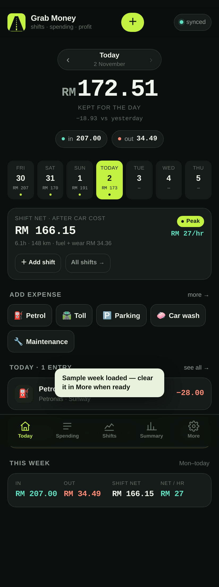

# Baki — what your shift really pays

A money tracker for GrabCar driving. Every shift is one payout; Baki subtracts what the car
actually costs to earn it — fuel, wear, the daily Grab insurance — and shows what is left, plus
where the rest of your money went. Works on a phone and a laptop, with optional live sync.

No accounts, no subscriptions, no internet needed. Everything is one HTML file plus a
small local sync server.



---

## Start it

**You need:** Node.js 18+ on the laptop (check with `node -v` — install from
[nodejs.org](https://nodejs.org) if missing).

```bash
cd grab-tracker
./sync.sh
```

It prints something like:

```
  On this computer : http://localhost:8787
  On your phone    : http://192.168.1.7:8787   (wlp5s0)
```

| Device | What to do |
|---|---|
| **Laptop** | Open `http://localhost:8787` |
| **Phone** | On the same Wi-Fi, open the `192.168.x.x` address in Chrome. Then install it (see below). |

Both devices now show the same entries. Add something on the phone and the laptop picks it
up within ~12 seconds, and the other way round. The sync chip in the top-right says
**synced** when the connection is healthy.

Close the server window when you're done; entries are saved in `data.json`.

> **If the address stops working:** your laptop's Wi-Fi IP can change when you reconnect.
> Run `./sync.sh` again and use the new address. Because browser storage is tied to the
> address, an old address keeps the old data — use **More → Download** to back up first,
> then **Choose file** on the new address to bring it across.

---

## Install it like an app (phone)

**Why plain HTTP can't install.** Chrome only allows installs (and offline caching) on
`localhost`, `127.0.0.1`, or **HTTPS**. `http://192.168.x.x:8787` is a plain-HTTP LAN address,
so Chrome blocks the service worker and says *"this app cannot be installed"*; the
"Add to Home screen" shortcut opens in a browser tab instead. That is a browser rule, not a bug.

**Fix it once with local HTTPS:**

```bash
./tools/setup-https.sh      # creates a private CA + certificate for this laptop
./sync.sh                   # now also prints an https:// address
```

1. **Phone:** open `http://<laptop-ip>:8787/ca.crt` and save the file.
2. **Phone:** Settings → Security → Encryption & credentials →
   Install a certificate → **CA certificate** → pick the downloaded file.
3. **Phone:** open `https://<laptop-ip>:8443` → Chrome **⋮ → Install app**.

It installs as a real app: own icon, full screen, no address bar, works offline.
The first visit may still show "Not secure" until the CA is trusted — install works anyway,
and the padlock appears once it is.

- **iPhone/Safari:** Share → **Add to Home Screen** (iOS ignores the manifest install prompt,
  but the home-screen app still works; trust the CA the same way).
- The plain `http://…:8787` address keeps working for a quick look, just without install/offline.
- If your Wi-Fi IP changes, re-run `./tools/setup-https.sh`; the phone doesn't need to re-trust.

## Out driving, no Wi-Fi

The app is cached on your phone after the first open, so it **works with no signal**:

1. Open it (home screen icon works) — it loads from the phone's cache.
2. Log your shift, petrol, tolls as usual. The chip says **no signal · saved here**.
3. Back on home Wi-Fi with the laptop running, it **syncs automatically** — no taps needed.
   The chip goes back to **synced**.

Nothing is lost in between: entries live on the phone until they reach the laptop.

| Chip says | Meaning |
|---|---|
| **synced** | Phone and laptop match |
| **saved · will sync** | You added something while the laptop was unreachable; it will upload |
| **no signal · saved here** | No internet; entries are safe on the phone |
| **this device** | Opened without the sync server (device-only mode) |

## Made to be looked at

- **Light and dark.** Follows your phone by default; **More → Appearance** pins it. Both are
  tuned separately — the light theme is a soft pastel wash with frosted cards, not an inversion.
- **Type.** Inter for reading, Space Grotesk for headings and the big figures.
- **Recurring notes become categories.** Log the same note under **Other** twice and a card
  offers to make it its own category. One tap accepts, the × says not now — the app never
  reorganises your data on its own.
- **The bars get out of the way.** The header hides while you scroll down and returns on the
  way up, so the numbers are never half-hidden behind chrome.

## Using it day to day

**One income source: the shift.** Everything you're paid for a session — payout, tips, bonuses,
cash fares — goes into one number on the shift. There is no income entry to type, and nothing to
reconcile.

| Tab | Answers | Use it for |
|---|---|---|
| **Shifts** | "Was that drive worth my time?" | One record per shift: hours, km, total received, tolls |
| **Today** | "What did I spend today?" | Petrol, food, phone, service |
| **Spending** | "What did I spend this month?" | Every purchase, searchable and filterable |
| **Summary** | "How did the month go?" | Cash kept, car funds, trend, breakdown |

Cash you end up holding (unspent fares, loose change) is **emergency money** — the tracker
doesn't chase it, so small leftovers never become a bookkeeping problem.

### Log a shift (the important one)

**Shifts → ＋ Log shift** after each drive:

1. **Hours online** — include waiting time (that's the honest denominator).
2. **Odometer** start/end — start pre-fills from your last shift, distance is calculated.
   No odometer? Type the km, or it estimates from hours × average speed.
3. **Net earnings** — the **"Your net earnings"** figure from Grab → Earnings. It already
   includes incentives, tips and cash fares, with the 20% commission deducted, so enter it
   as-is and don't add those separately.

   Grab lists **toll reimbursements separately** (Earnings → Reimbursements). Since you get
   that money back, leave **Tolls / parking** blank when the toll was reimbursed — only fill it
   in for a toll or parking fee you actually absorbed.
4. Incentives/bonus and tolls/parking are optional.

The sheet shows the result live before you save: **net after car cost, RM/hr, RM/km and a
rating**. Saving lands you on the Shifts month view.

### Where the money goes (per shift)

Every shift splits its payout into four buckets, shown live in the form before you save:

```
Gross payout RM 139.00
├── Fuel fund       RM  15.64   (110 km × RM0.142)
├── Wear fund       RM   9.90   (110 km × RM0.090)
├── Grab insurance  RM   7.50   (the daily cover)
└── Take-home       RM 105.96
```

The Grab insurance is billed separately from the payout, so it counts twice on purpose: on the
shift (it lowers net pay and RM/hr) and as a matching **Grab insurance** expense entry (it lowers
cash kept). One entry per shift is created and removed automatically — never log it by hand.

Fuel and wear come off the **gross payout**, so take-home equals the net figure. (Do not
subtract them again from a net number — that double-counts.)

### The two car funds

The funds are **balances**, not one-off costs:

| Fund | Fills from | Drained by |
|---|---|---|
| **Fuel** | km × fuel rate | every Petrol purchase you log |
| **Wear & service** | km × RM0.09 | Maintenance, Car wash, Road tax |

**Summary → Car funds** shows each balance and then **Spendable**:

```
Spendable = cash kept − money sitting in the funds
```

That RM113.46 shift is *not* RM113.46 of spending money — RM25.54 of it is car money you
haven't spent yet. Spendable is the honest number. A negative fuel balance is normal straight
after filling the tank: you bought petrol you haven't burned yet.

The annual car insurance is not a separate category — it is covered by the wear fund's per-km
rate, so when you pay it, log it under **Maintenance**. Fixed costs (road tax, insurance) are car
ownership costs
rather than day-to-day spending.

### Traffic changes the fuel cost

Fuel per km isn't fixed: `fuel price ÷ km/L`. Each shift can set its own efficiency —

| Profile | km/L | Fuel per km |
|---|---|---|
| Smooth (highway / light traffic) | 14 | RM 0.142 |
| Mixed (steady city) | 12 | RM 0.166 |
| Jam (gridlock, idling) | 11 | RM 0.181 |
| Default | from Settings | |

A gridlock shift therefore earns less even at the same payout. Overrides are stored per
shift, so changing the default later doesn't rewrite history.

### What the Shifts tab shows

- **Net per hour online** with a five-band ruler (Quiet → Peak) and a marker,
  plus whether you're above or below your own floor.
- **Net profit, distance, gross RM/km, net RM/km** for the month.
- **Cash kept vs spent** (Summary) — a 12-month chart with two lines, so you can see months
  where you earned well and months where you spent well.
- **Best windows** — your shifts grouped by start time, ranked by net rate. This is how you
  find out that your 2pm shift is actually the RM17/hr one.
- **Every shift** as a card with its rate and band, tap to edit.
- **Your running cost** — the RM/km the app is deducting, with an *edit* link.

Set your own numbers in **More → Vehicle costs & target**: fuel price, km/L, wear per km,
your RM/hr floor, and the average-speed fallback.

**Forgot something from yesterday?** Tap `‹` next to the date, or a day in the strip in
**Today**, then add it there. Backdating is automatic.

**Fix a mistake** — tap any entry or shift to edit it. Deleting offers **Undo** for 5 seconds.

**Make it yours** — **More** lets you add or remove income/expense categories.

---

## Coming back after a break

Pick up from **[NEXT-SESSION.md](NEXT-SESSION.md)** — it has the state at handoff and the
checklist (start server → upload backup → review).

There are two reminders, pick whichever suits you:

- **Weekly, Wed + Sun 8pm** in this chat (fires when you reopen the session).
- **`baki-reminder.ics`** — import into Google Calendar / your phone calendar so the
  reminder arrives even when this app is closed.

## Checking nothing is broken

```bash
./tools/test.sh            # every suite, against a throwaway server
./tools/test.sh ui3 ui5    # just some
```

It starts the server on its own port with its own data file, runs 17 suites, prints a summary
and cleans up. It refuses to run on 8787, so it can never touch your real data.

## Keeping your data safe

| What | How |
|---|---|
| **Backup** | **More → Download** saves a `.json` file. Do this weekly, and before changing phones. |
| **Restore** | **More → Choose file**. It only ever **merges** — it can add rows back but never deletes. |
| **Snapshots** | **More → Snapshots**. The app keeps the last 7 restore points on this device, one an hour, for undoing a wrong tap. |
| **Spreadsheet** | **More → Export** makes a CSV for Excel or Google Sheets. |
| **Second copy** | The server also keeps the last 30 versions in `backups/`, so a bad sync can be undone by copying one back to `data.json`. |

Without the sync server the app still works — entries are saved on that device only, and
the top-right chip shows **this device**.

---

## Phone vs laptop

One codebase, two shapes:

- **Phone** — app layout: single column, bottom tab bar, thumb-sized targets, installs to the
  home screen and works offline.
- **Laptop** — dashboard layout: a top tab bar and a two-column grid (today + shifts on the
  left, the day's ledger and this week on the right). Same components, same colours, wider canvas.
  The switch is automatic at 1024px.

Both share the same data through `./sync.sh`, so the laptop is the place to review a week and
the phone is the place to log a shift at the roadside.

## What's in this folder

| File | Purpose |
|---|---|
| `index.html` | The whole app: UI, logic, styles. Open it directly and it still works (device-only mode). |
| `server.mjs` | Tiny Node server: serves the app and shares one `data.json` between devices. |
| `sync.sh` | Launcher for the server — this is the only thing you normally run. |
| `sw.js` | Makes the app open offline on your phone. |
| `manifest.webmanifest` | Tells Chrome the app's name, icon and colours so it can be installed. |
| `icon-48/96/192/512/1024.png`, `icon-maskable-512.png`, `apple-touch-icon.png` | App icons — a road mark drawn as geometry at each size (6× supersampled, never upscaled). Same mark as the header. Regenerate with `node tools/make-icons.mjs`. |
| `tools/make-icons.mjs` | Draws the icons (no image software needed). |
| `data.json` | Your entries (created on first run). **This is your master copy.** |
| `backups/` | Automatic previous versions of `data.json` (last 30). |
| `screenshots/` | Preview images. |

### Commands

```bash
./sync.sh                 # start on port 8787
PORT=9000 ./sync.sh       # different port
DATA_FILE=/path/x.json ./sync.sh   # custom data file
```

`ALLOW_RESET=1` additionally enables a local-only `POST /api/reset` endpoint (used by the
test suite; leave it off normally).

---

## Good to know

- **Amounts are in RM** and stored as whole cents, so no rounding drift.
- **Default running cost is RM0.232/km** (fuel RM1.99/L ÷ 14 km/L = RM0.142 + wear RM0.09).
  That reflects the BUDI95 rate for e-hailing, not the RM2.60 general pump price.
- **Shift maths:** net = payout + incentives − (km × running cost) − tolls/parking.
  Insurance, road tax and car loan are *fixed* costs, excluded by default — add them to the
  wear figure if you want them included.
- **Dates are local** (Asia/Kuala_Lumpur), so a 1am entry counts for that day, not yesterday.
- **Privacy:** nothing leaves your network. The server only listens on your laptop.
- **Only one server should run per data file** — don't point two laptops at the same folder.
- **Open the app once while on home Wi-Fi** so the offline copy is saved. After that it works anywhere.
- **HTTPS:** not needed on your home Wi-Fi. If you ever expose this to the internet, put it
  behind HTTPS and a password first.

## Troubleshooting

| Symptom | Fix |
|---|---|
| Phone can't open the address | Same Wi-Fi? Laptop firewall blocking 8787? Try another browser. |
| Chip says **offline · saved** | Server stopped or IP changed — restart `./sync.sh`, and reconnect from **More**. |
| Chip says **saved · will sync** | Entries from the road waiting for the laptop. Get on home Wi-Fi with `./sync.sh` running and wait a few seconds. |
| Chip says **this device** | You opened the file directly or on a different port. Start the server and use its address. |
| "Port already in use" | The tracker is probably already running — just open it. Otherwise `PORT=8788 ./sync.sh`. |
| Chrome says "app cannot be installed" | You're on an old address, a stale server, or opened the file directly. Stop old copies, run `./sync.sh`, open the printed address, reload. |
| Lost entries after reconnecting to Wi-Fi | New IP = new storage. Restore your latest backup, or keep a stable IP/hostname. |

---

Built for a GrabCar driver in KL. If you later want true cloud sync (no laptop needed), the
data model is plain JSON and can move to Google Sheets or a hosted database without
changing how the app works.
